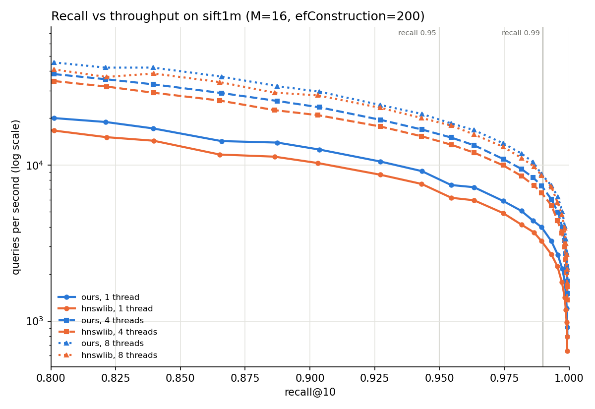

# hnsw-cpp

From-scratch HNSW approximate nearest neighbor index in C++17.

## Status

Work in progress. See docs/TASK.md.

| Milestone | State |
|---|---|
| M1: CMake project, fvecs/ivecs IO, brute-force kNN, scalar L2, unit tests | done |
| M2: HNSW build and search (scalar, single-threaded baseline) | done |
| M3: contiguous layout, epoch visited list, allocation-free heaps, prefetch, AVX2+FMA kernel | done |
| M4: index file format (save, mmap/read load, validation), thread pool, batch query API | done |
| M5a: benchmark infrastructure (dataset scripts, ground-truth validation, build/search/load-time harness with hnswlib baseline, tests) | done |
| M5b: SIFT1M runs, ablation, profile, plot, results table | done (see [Results](#results)) |
| M6: Python bindings (pybind11), tests and example | done (see [Python bindings](#python-bindings-m6)) |
| M7a: sanitizer runs (ASan, UBSan, TSan with GCC and clang), libFuzzer targets for the loader and the vector readers | done (see [Sanitizers and fuzzing](#sanitizers-and-fuzzing-m7a)) |
| M7b: CI, design doc, README | pending |

Benchmark results are in [Results](#results). The tools and the method are described in
[bench/README.md](bench/README.md). SIFT1M downloads and validates on this machine
(`bench/get_sift.sh`), so no synthetic substitute is needed.

### Build options (M3)

Each optimization can be switched off for ablation; all default to ON.

| CMake option | OFF behavior |
|---|---|
| `HNSW_OPT_EPOCH_VISITED` | visited marks are a fresh byte array per search pass |
| `HNSW_OPT_ALLOC_FREE_HEAPS` | search heaps are `std::priority_queue` |
| `HNSW_OPT_PREFETCH` | no software prefetch |
| `HNSW_NATIVE` | no `-march=native`; the AVX2 kernel still builds with per-file flags and is chosen at run time |

The distance kernel is chosen at run time: AVX2+FMA when the CPU supports it, else scalar. Pass `hnsw::l2_squared_scalar` explicitly to use the scalar reference.

### Index files (M4)

`HnswIndex::save(path)` writes the index atomically (temporary file plus rename).
`LoadedIndex::open(path, options)` loads it read-only, either memory-mapped
(`LoadMode::Mmap`, searched in place) or read into memory (`LoadMode::Read`), with the
same search API and bit-identical results. The byte-level format and every check the
loader makes are in [docs/FORMAT.md](docs/FORMAT.md). Files are treated as untrusted:
with `validate_deep` on (the default) any file that loads is safe to search; with it
off, only load files you trust. `LoadedIndex::from_memory(data, size, options)` runs the same
validation on a file image already in memory (64-byte aligned) and searches it in place.

### Concurrent search (M4)

`ThreadPool(n_threads)` (`include/hnsw/thread_pool.h`) is a persistent pool reused across
calls; `n_threads = 0` uses `std::thread::hardware_concurrency()`. `search_batch(queries,
n_queries, k, ef, out_ids, out_dists, pool)` on `HnswIndex` and `LoadedIndex` writes
`n_queries * k` results row-major into caller arrays, padding short rows with
`hnsw::kNoNeighbor` (`UINT32_MAX`) and `+infinity`, and returns exactly what sequential
`search` returns. Each pool thread keeps its own `SearchScratch`. Calling `search` from
your own threads at the same time is also safe, as long as each thread uses its own
`SearchScratch` and nothing is inserting.

`-DHNSW_SANITIZE=thread` builds with ThreadSanitizer (not combinable with `address`).

### Python bindings (M6)

`import hnsw_cpp` offers `Index` (build, `add`, `search`, `save`), `load(path, mode, validate)`
returning a read-only `LoadedIndex`, and type stubs. Distances are squared L2; missing results
are id `-1` with distance `+inf`. Inputs must already be C-contiguous float32 numpy arrays;
nothing is copied or converted, and wrong input raises `TypeError` or `ValueError` saying how
to fix it. Any number of searches may run at once; `add` is exclusive. `validate="shallow"`
requires a trusted file.

```
python3 -m venv .venv && . .venv/bin/activate
pip install .                      # scikit-build-core builds a portable (no -march=native) wheel
python python/examples/quickstart.py
python -m unittest discover -s python/tests
```

In-tree: `cmake -B build -DHNSW_BUILD_PYTHON=ON` (needs pybind11 and Python development files)
registers `python_tests` and `python_quickstart` with ctest, except in sanitizer builds, where the
extension is built but not run by ctest (`scripts/sanitize_python.sh` runs it under ASan). The Python package makes no performance claim; the benchmarks
below measure the C++ library only.

### Sanitizers and fuzzing (M7a)

`scripts/sanitize.sh <gcc|clang> <address|undefined|address+undefined|thread>` builds a fresh
tree with the benchmark tools and the Python extension and runs the full ctest suite; UBSan
aborts on the first finding and ASan runs with leak detection. `scripts/sanitize_python.sh
<gcc|clang>` runs the Python tests on the ASan-built extension with the runtime preloaded.
The saved outputs of every combination are in [docs/evidence](docs/evidence).

libFuzzer targets for the index loader and the fvecs/ivecs readers live in
[tests/fuzz](tests/fuzz/README.md) (`-DHNSW_BUILD_FUZZ=ON`, clang, ASan+UBSan). The loader
target drives the same validation code as `LoadedIndex::open` and searches every image that
deep validation accepts. Seeds, the minimized corpus and past crashes are replayed by ctest in
every build. Fuzz run logs and a summary parsed from them are in docs/evidence.

Sanitizer findings in the hnswlib baseline (benchmark only, not our code) are exempted for its
translation unit; the reasons are in bench/CMakeLists.txt.

## Results

Measured on SIFT1M against hnswlib on one laptop. Every number below is generated by
`bench/make_report.py` from the raw files in [bench/results/](bench/results/), which
`bench/run_all.sh` wrote. `bench/check_readme.py` checks that each of those numbers
appears in `bench/results/summary.md`, and that the text outside the generated block
contains no numbers of its own. The method is described in [bench/README.md](bench/README.md).

<!-- RESULTS:BEGIN -->
<!-- Generated by bench/make_report.py --update-readme; do not edit. -->

Generated from [bench/results/summary.md](bench/results/summary.md), which also lists the full environment. Values are truncated, not rounded, to the digits shown.

**Verdict** (faster or slower only where the pass-QPS ranges do not overlap): Single-threaded, ours is faster than hnswlib at recall@10 >= 0.95 (7436 vs 6158 median QPS, ratio 1.207); ours is faster than hnswlib at recall@10 >= 0.99 (3254 vs 2665 median QPS, ratio 1.220). With 4 threads, ours is faster than hnswlib at recall@10 >= 0.95 (14990 vs 13469 median QPS, ratio 1.112); ours is faster than hnswlib at recall@10 >= 0.99 (6029 vs 5496 median QPS, ratio 1.096). With 8 threads, the difference between ours and hnswlib is not distinguishable from noise (ranges overlap) at recall@10 >= 0.95 (18475 vs 17865 median QPS, ratio 1.034); the difference between ours and hnswlib is not distinguishable from noise (ranges overlap) at recall@10 >= 0.99 (7383 vs 7215 median QPS, ratio 1.023).

**Noise.** Repeating the 4 headline single-thread measurements at the end of the run gave repeat / sweep median-QPS ratios from 0.994 to 1.071. 34 measured points have a pass spread above 15% ((max - min) / median): 10 in `sweep_t1.json`, 6 in `sweep_t4.json`, 12 in `sweep_t8.json`, 2 in `repeat_t1.json`, 4 in `ablation`; 21 of the 28 flagged sweep points are at ef <= 64, where a pass is shortest. They are listed under High-spread points.

### Headline: QPS at the first ef reaching each recall target

Each system at its own first swept ef whose recall@10 reaches the target (no interpolation).

| threads | recall@10 target | system | ef | recall@10 | QPS (median) | QPS range (slowest to fastest pass) |
|---|---|---|---|---|---|---|
| 1 | >= 0.95 | ours | 56 | 0.9544 | 7436 | 6802 to 8083 |
| 1 | >= 0.95 | hnswlib | 56 | 0.9545 | 6158 | 5634 to 6644 |
| 1 | >= 0.99 | ours | 160 | 0.9931 | 3254 | 3002 to 3299 |
| 1 | >= 0.99 | hnswlib | 160 | 0.9932 | 2665 | 2459 to 2720 |
| 4 | >= 0.95 | ours | 56 | 0.9544 | 14990 | 14035 to 15118 |
| 4 | >= 0.95 | hnswlib | 56 | 0.9545 | 13469 | 13228 to 13690 |
| 4 | >= 0.99 | ours | 160 | 0.9931 | 6029 | 5870 to 6068 |
| 4 | >= 0.99 | hnswlib | 160 | 0.9932 | 5496 | 4948 to 5598 |
| 8 | >= 0.95 | ours | 56 | 0.9544 | 18475 | 17615 to 18851 |
| 8 | >= 0.95 | hnswlib | 56 | 0.9545 | 17865 | 15569 to 18013 |
| 8 | >= 0.99 | ours | 160 | 0.9931 | 7383 | 7204 to 7660 |
| 8 | >= 0.99 | hnswlib | 160 | 0.9932 | 7215 | 6909 to 7353 |

A system is called faster or slower only when the two systems' pass-QPS ranges (slowest to fastest pass) do not overlap; otherwise the comparison is reported as not distinguishable from noise. The median ratio is shown either way.

| threads | recall@10 target | ours QPS / hnswlib QPS (median) | ours is |
|---|---|---|---|
| 1 | >= 0.95 | 1.207 | faster |
| 1 | >= 0.99 | 1.220 | faster |
| 4 | >= 0.95 | 1.112 | faster |
| 4 | >= 0.99 | 1.096 | faster |
| 8 | >= 0.95 | 1.034 | not distinguishable from noise (ranges overlap) |
| 8 | >= 0.99 | 1.023 | not distinguishable from noise (ranges overlap) |

Multi-thread result ids identical to single-thread (same system and ef, compared by hash):

| threads | identical points |
|---|---|
| 4 | 50 of 50 |
| 8 | 50 of 50 |



### Build, index size, memory

| system | vectors | M | efConstruction | build s (each run, in order) | build s (median) | build s (range) | index bytes on disk | index MiB |
|---|---|---|---|---|---|---|---|---|
| ours | 1000000 | 16 | 200 | 425.2, 420.7, 409.4 | 420.7 | 409.4 to 425.2 | 717532052 | 684.2 |
| hnswlib | 1000000 | 16 | 200 | 438.6, 441.6, 437.5 | 438.6 | 437.5 to 441.6 | 660565344 | 629.9 |

Peak memory of the build process (VmHWM, kB); the dataset-only value is VmHWM right after loading the base vectors, and the delta is the peak above it:

| system | VmHWM end | VmHWM after dataset load (dataset only) | delta |
|---|---|---|---|
| ours | 1230752 | 504568 | 726184 |
| hnswlib | 1244412 | 504548 | 739864 |

### Load time

**Warm page cache** (each strategy loaded once untimed first), 5 repetitions; first 1000 queries at ef 100, single-threaded, fresh scratch:

| strategy | load ms (median) | load ms (range) | first 1000 queries ms (median) | first 1000 queries ms (range) |
|---|---|---|---|---|
| ours-mmap-shallow | 0.0324 | 0.0319 to 0.0336 | 205 | 204 to 210 |
| ours-mmap-deep | 76.4 | 75.2 to 84.8 | 208 | 206 to 222 |
| ours-read-shallow | 251 | 245 to 281 | 258 | 253 to 268 |
| ours-read-deep | 327 | 326 to 405 | 267 | 252 to 286 |
| hnswlib-load | 671 | 658 to 867 | 251 | 248 to 262 |

**Cold page cache**: `sync; echo 3 | sudo -n tee /proc/sys/vm/drop_caches > /dev/null` before every load, 5 repetitions, same query settings:

| strategy | load ms (median) | load ms (range) | first 1000 queries ms (median) | first 1000 queries ms (range) |
|---|---|---|---|---|
| ours-mmap-shallow | 9.39 | 6.16 to 12.3 | 1332 | 1058 to 1495 |
| ours-mmap-deep | 466 | 455 to 1141 | 312 | 284 to 352 |
| ours-read-shallow | 497 | 467 to 845 | 352 | 313 to 433 |
| ours-read-deep | 656 | 543 to 845 | 372 | 356 to 442 |
| hnswlib-load | 1108 | 879 to 1165 | 430 | 273 to 573 |

**Cold vs warm**, time until the first 1000 queries are answered (median load + median first-queries time):

| strategy | warm ms | cold ms |
|---|---|---|
| ours-mmap-shallow | 205 | 1342 |
| ours-mmap-deep | 284 | 779 |
| ours-read-shallow | 510 | 849 |
| ours-read-deep | 594 | 1029 |
| hnswlib-load | 922 | 1538 |

WSL2 caveat: dropping caches empties the Linux VM's page cache only. The VM's virtual disk is a file on the Windows host, which may still hold it in the Windows file cache, so cold here means cold for Linux, not necessarily a read from the physical drive. With mmap, the cold cost moves from the load into the first queries, which fault pages in on demand.

### Ablation

Single-threaded, pinned, the same `ours.hnsw` for every variant; 5 repetitions per combination, each its own process (1 warm-up + 1 timed pass), combinations interleaved round robin. QPS is queries / median timed pass. Every ratio is of medians; it is marked "within noise" when the QPS ranges (slowest to fastest repetition) of the two configurations overlap, and such a ratio is not a measured speedup or slowdown. Recall@10 per kernel: ef 56: scalar 0.9544, AVX2 0.9544; ef 160: scalar 0.9931, AVX2 0.9931.

**Each optimization alone** (QPS; ratio over all off with the scalar kernel):

| optimization | ef 56 (recall >= 0.95) | ef 160 (recall >= 0.99) |
|---|---|---|
| epoch visited list | 3916 (x1.068) | 1641 (x1.004, within noise) |
| allocation-free heaps | 3744 (x1.021, within noise) | 1589 (x0.972, within noise) |
| software prefetch | 4924 (x1.343) | 2155 (x1.318) |
| AVX2+FMA kernel | 6289 (x1.716) | 2736 (x1.674) |

Baseline, all off (scalar): ef 56: 3665 QPS (3477 to 3750), ef 160: 1634 QPS (1611 to 1644).

**Cumulative** (QPS; total ratio over all off, and the step over the row above):

| configuration | ef 56 (recall >= 0.95) | ef 160 (recall >= 0.99) |
|---|---|---|
| all off (scalar) | 3665 | 1634 |
| + epoch visited list | 3916 (total x1.068; step x1.068) | 1641 (total x1.004, within noise; step x1.004, within noise) |
| + allocation-free heaps | 4026 (total x1.098, within noise; step x1.028, within noise) | 1672 (total x1.023, within noise; step x1.018, within noise) |
| + software prefetch | 5336 (total x1.456; step x1.325) | 2234 (total x1.367; step x1.336) |
| + AVX2+FMA kernel | 7839 (total x2.138; step x1.468) | 3172 (total x1.940; step x1.419) |

**Leave one out** from the full configuration (ef 56: 7839 QPS (7717 to 7962), ef 160: 3172 QPS (3104 to 3249)):

| configuration | ef 56 (recall >= 0.95) | ef 160 (recall >= 0.99) |
|---|---|---|
| without epoch visited list | 7221 (full / this: x1.085) | 3185 (full / this: x0.995, within noise) |
| without allocation-free heaps | 7783 (full / this: x1.007, within noise) | 3119 (full / this: x1.016, within noise) |
| without software prefetch | 6968 (full / this: x1.124) | 2835 (full / this: x1.118) |
| without AVX2+FMA kernel | 5336 (full / this: x1.468) | 2234 (full / this: x1.419) |

All 16 combinations (QPS median, slowest to fastest repetition):

| enabled | ef 56 (recall >= 0.95) | ef 160 (recall >= 0.99) |
|---|---|---|
| all off (scalar) | 3665 (3477 to 3750) | 1634 (1611 to 1644) |
| simd | 6289 (5809 to 6370) | 2736 (2391 to 2782) |
| prefetch | 4924 (3930 to 4966) | 2155 (1962 to 2192) |
| prefetch+simd | 7058 (6625 to 7135) | 3056 (2941 to 3107) |
| heaps | 3744 (3652 to 3793) | 1589 (1492 to 1658) |
| heaps+simd | 6410 (5542 to 6436) | 2599 (2499 to 2839) |
| heaps+prefetch | 4724 (4420 to 4976) | 2181 (1964 to 2194) |
| heaps+prefetch+simd | 7221 (7175 to 7298) | 3185 (3053 to 3204) |
| epoch | 3916 (3868 to 3946) | 1641 (1514 to 1649) |
| epoch+simd | 6599 (6543 to 6916) | 2767 (2732 to 2795) |
| epoch+prefetch | 5333 (4813 to 5349) | 2208 (1971 to 2230) |
| epoch+prefetch+simd | 7783 (7150 to 7814) | 3119 (3057 to 3155) |
| epoch+heaps | 4026 (3559 to 4032) | 1672 (1489 to 1689) |
| epoch+heaps+simd | 6968 (6023 to 6999) | 2835 (2740 to 2864) |
| epoch+heaps+prefetch | 5336 (5252 to 5431) | 2234 (1967 to 2264) |
| epoch+heaps+prefetch+simd | 7839 (7717 to 7962) | 3172 (3104 to 3249) |

Result-id check (`ablation_check.json`): identical ids for every same-kernel combination: True.


### Layout ablation

Memory layout, measured on the full base (1000000 vectors). The M2 build time was projected from a 100000-vector build (51.4 s) to 617.0 s for 1000000 vectors (n log n; limit 5400.0 s). M2 baseline (pre-layout, scalar kernel) versus the all-off scalar variant (current layout) on an index with the same graph, both single-threaded and pinned.

How the samples were taken: one M2 process built the index once, then ran 7 repetitions M_0 .. M_6 (each 1 warm-up + 1 timed pass per ef). Before M_0 and after every M_r it ran the all-off variant once as a separate process, giving 8 all-off samples A_0 .. A_7 in the order A_0 M_0 A_1 M_1 ... M_6 A_7. M_r sits between A_r and A_(r+1). The "before" group A_0 .. A_6 and the "after" group A_1 .. A_7 share 6 of their 7 samples (A_1 .. A_6), so they are not independent: they differ only in A_0 versus A_7. At ef 56 the medians are A_4 (2.6936 s) and A_1 (2.6933 s), close enough that both truncate to the same QPS. At ef 160 both groups' median is the same sample, A_1, so the two values are identical. The comparison below therefore uses all 8 all-off samples as one group, and lists both overlapping groups and every raw sample.

| ef | recall@10 | M2 QPS median (range) | all-off QPS median (range), all 8 samples | all-off / M2 (medians) | current layout is |
|---|---|---|---|---|---|
| 56 | 0.9544 | 2933 (2907 to 2942) | 3712 (3381 to 3755) | x1.265 | faster |
| 160 | 0.9931 | 1214 (1093 to 1262) | 1635 (1550 to 1648) | x1.346 | faster |

Overlapping groups (not independent; shown only to explain the identical values reported before):

| ef | before A_0..A_6 QPS | after A_1..A_7 QPS | before median s | after median s |
|---|---|---|---|---|
| 56 | 3712 | 3712 | 2.6936 | 2.6933 |
| 160 | 1638 | 1638 | 6.1032 | 6.1032 |

Every raw timed pass, in execution order (seconds for 10000 queries):

| run | ef 56 s | ef 160 s |
|---|---|---|
| A_0 | 2.7521 | 6.4514 |
| M_0 | 3.4089 | 7.9668 |
| A_1 | 2.6933 | 6.1032 |
| M_1 | 3.4077 | 8.2311 |
| A_2 | 2.6892 | 6.1683 |
| M_2 | 3.4005 | 9.1462 |
| A_3 | 2.7086 | 6.1378 |
| M_3 | 3.3980 | 7.9353 |
| A_4 | 2.6936 | 6.0651 |
| M_4 | 3.4291 | 8.9694 |
| A_5 | 2.9570 | 6.0970 |
| M_5 | 3.4398 | 7.9234 |
| A_6 | 2.6628 | 6.0807 |
| M_6 | 3.4129 | 9.0236 |
| A_7 | 2.6829 | 6.1251 |

Result-id check (`layout_check.json`): M2 ids equal the all-off variant's: True.

### Profile

Sampled with `perf record -e cpu-clock` (user-space samples, whole process: includes loading and the untimed warm-up and recall code), single-threaded and pinned. Top symbols (`perf report --stdio --no-children`, full lists in `bench/results/perf/report_*.txt`):

ours:

| samples | object | symbol |
|---|---|---|
| 56.41% | bench_search | `hnsw::l2_squared_avx2` |
| 41.90% | bench_search | `hnsw::detail::search_layer` |
| 1.24% | bench_search | `hnsw::detail::greedy_closest` |
| 0.06% | bench_search | `hnsw::search_graph_into` |
| 0.02% | bench_search | `double ::timed_pass [clone .isra.0]` |
| 0.02% | bench_search | `std::vector::reserve` |
| 0.01% | bench_search | `hnsw::LoadedIndex::search_into const` |
| 0.01% | sha256sum | `0x0000000000301bb7` |

hnswlib:

| samples | object | symbol |
|---|---|---|
| 51.18% | bench_search | `hnswlib::HierarchicalNSW::searchKnn const` |
| 46.55% | bench_search | `hnswlib::L2SqrSIMD16ExtAVX` |
| 0.35% | bench_search | `hnswlib::HierarchicalNSW::loadIndex` |
| 0.26% | libc.so.6 | `llseek@GLIBC_2.2.5` |
| 0.14% | libc.so.6 | `malloc` |
| 0.11% | bench_search | `std::_Hashtable::_M_insert_unique_node` |
| 0.10% | libc.so.6 | `cfree@GLIBC_2.2.5` |
| 0.09% | libstdc++.so.6.0.35 | `std::basic_filebuf::seekoff` |

`perf stat` over the same runs (user space):

| system | task-clock ms | cycles | instructions | IPC | cache misses / references |
|---|---|---|---|---|---|
| ours | 13861 | 57530379557 | 24600158222 | 0.42 | 81.2% |
| hnswlib | 17862 | 71999932708 | 29624829963 | 0.41 | 78.5% |

Hardware counters: exposed (user space).

```
perf: /usr/bin/perf
perf version 7.0.14
binary: build-prof/bench/bench_search
pinned cpu: 2
ef: 56 (smallest ef with ours recall@10 >= 0.95 in sweep_t1.json)
perf_event_paranoid: 2
```

### Reproducibility

Headline single-thread points measured again at the end of the run (`repeat_t1.json`) against the main sweep (`sweep_t1.json`):

| system | ef | sweep QPS | repeat QPS | repeat / sweep | same result ids |
|---|---|---|---|---|---|
| hnswlib | 56 | 6158 | 6568 | 1.066 | True |
| hnswlib | 160 | 2665 | 2664 | 0.999 | True |
| ours | 56 | 7436 | 7964 | 1.071 | True |
| ours | 160 | 3254 | 3237 | 0.994 | True |

### High-spread points

Points whose timed passes spread by more than 15% ((max - min) / median):

| file | point | passes | spread |
|---|---|---|---|
| sweep_t1.json | ours ef 12 threads 1 | 7 | 32.5% |
| sweep_t1.json | hnswlib ef 12 threads 1 | 7 | 42.3% |
| sweep_t1.json | ours ef 14 threads 1 | 7 | 26.1% |
| sweep_t1.json | hnswlib ef 20 threads 1 | 7 | 20.8% |
| sweep_t1.json | ours ef 24 threads 1 | 7 | 19.1% |
| sweep_t1.json | hnswlib ef 24 threads 1 | 7 | 22.3% |
| sweep_t1.json | ours ef 40 threads 1 | 7 | 37.2% |
| sweep_t1.json | ours ef 56 threads 1 | 7 | 17.3% |
| sweep_t1.json | hnswlib ef 56 threads 1 | 7 | 16.6% |
| sweep_t1.json | hnswlib ef 96 threads 1 | 7 | 17.4% |
| sweep_t4.json | hnswlib ef 10 threads 4 | 7 | 17.7% |
| sweep_t4.json | ours ef 12 threads 4 | 7 | 23.0% |
| sweep_t4.json | hnswlib ef 12 threads 4 | 7 | 40.2% |
| sweep_t4.json | ours ef 16 threads 4 | 7 | 15.9% |
| sweep_t4.json | hnswlib ef 20 threads 4 | 7 | 16.5% |
| sweep_t4.json | ours ef 64 threads 4 | 7 | 16.4% |
| sweep_t8.json | ours ef 10 threads 8 | 7 | 24.3% |
| sweep_t8.json | hnswlib ef 10 threads 8 | 7 | 44.6% |
| sweep_t8.json | ours ef 16 threads 8 | 7 | 19.7% |
| sweep_t8.json | hnswlib ef 28 threads 8 | 7 | 16.8% |
| sweep_t8.json | hnswlib ef 32 threads 8 | 7 | 17.1% |
| sweep_t8.json | hnswlib ef 56 threads 8 | 7 | 15.5% |
| sweep_t8.json | hnswlib ef 128 threads 8 | 7 | 32.9% |
| sweep_t8.json | hnswlib ef 200 threads 8 | 7 | 15.7% |
| sweep_t8.json | ours ef 320 threads 8 | 7 | 16.6% |
| sweep_t8.json | hnswlib ef 320 threads 8 | 7 | 17.3% |
| sweep_t8.json | ours ef 400 threads 8 | 7 | 18.2% |
| sweep_t8.json | hnswlib ef 640 threads 8 | 7 | 17.9% |
| repeat_t1.json | ours ef 56 threads 1 | 7 | 33.3% |
| repeat_t1.json | hnswlib ef 56 threads 1 | 7 | 24.5% |
| ablation | simd ef 160 | 5 | 16.0% |
| ablation | prefetch ef 56 | 5 | 26.1% |
| ablation | heaps+simd ef 56 | 5 | 16.0% |
| ablation | epoch+heaps+simd ef 56 | 5 | 16.1% |

<!-- RESULTS:END -->

### How to read these numbers

- **Machine.** A laptop running Linux under WSL2 on Windows. Background Windows
  activity, power management and the WSL2 virtual machine all add noise that a
  dedicated Linux server would not have. Single-thread runs are pinned to one logical
  CPU, and multi-thread runs are not pinned. The power and session settings recorded
  by hand are listed in `bench/results/summary.md`.
- **Noise.** Each point is the median of several timed passes, and the spread of every
  point is stored. The generated "Noise" paragraph above states the measured run-to-run
  variation and where the high-spread points are. A comparison is called faster or
  slower only when the pass ranges of the two sides do not overlap; otherwise the
  generated text says it is not distinguishable from noise.
- **Cold-cache load time.** Measured with `bench/run_cold_loadtime.sh`, which drops the
  page cache (with `sudo`) before every load. Under WSL2 that clears the Linux VM's page
  cache only; Windows may still have the virtual disk cached, so "cold" means cold for
  Linux.

### Fairness notes

- Both systems build single-threaded, because ours has no concurrent insert. hnswlib
  can build in parallel.
- Index file sizes differ by design: our layer-zero records are padded to a cache line.
- hnswlib allocates its result and candidate heaps inside every query and takes a
  visited list from a mutex-protected pool. Ours reuses a caller-owned scratch and
  allocates nothing per query once warm. That difference is part of what is compared.
- Ours can map the index file and search it in place, or read it into memory. hnswlib's
  `loadIndex` always reads the whole file.
- Ours uses an explicit AVX2+FMA kernel. hnswlib uses the kernel its headers select
  under `-march=native`; the result files record which one (`L2SqrSIMD16ExtAVX` here).
- Both compile with the same flags in the same binaries. Multi-thread runs use the same
  thread pool and dispatch code for both systems.
- Peak memory comes from the kernel's VmHWM, which is not byte-exact.
