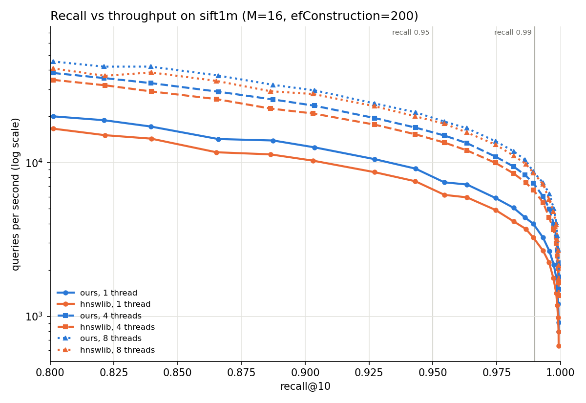
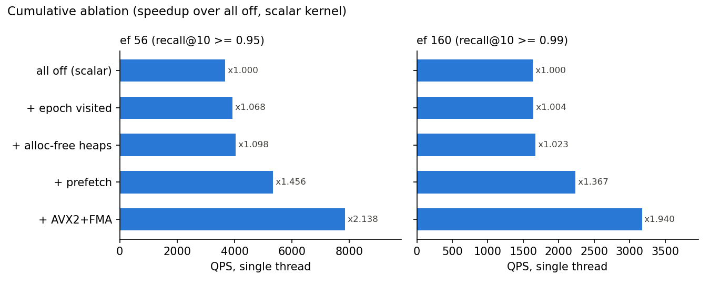

# Benchmark summary

Generated by `bench/make_report.py` from the files in this directory. Values are truncated, not rounded, to the digits shown.

## Environment

- Dataset: `sift1m`, 1000000 base vectors, 10000 queries, recall@10 against the first 10 ground-truth ids.
- CPU: Intel(R) Core(TM) i5-10300H CPU @ 2.50GHz, 4 cores / 8 logical CPUs; MemTotal 8040064 kB.
- Kernel: `6.18.33.1-microsoft-standard-WSL2` (WSL detected: True).
- Compiler: g++ (Ubuntu 15.2.0-16ubuntu1) 15.2.0 (`/usr/bin/c++`).
- Flags: `-O3 -DNDEBUG -std=c++17 -Wall -Wextra -march=native`; per file: `src/distance_avx2.cpp`: `-mavx2 -mfma`, `src/distance.cpp`: `-ffp-contract=off`; release build: True.
- Source: commit `b00ca421748cf5c16efc31da0c4426f3039c8963` (`m4-final-6-gb00ca42`, dirty: False).
- hnswlib: v0.9.0 (`d9b3608c83d83b46c96e25088cb1d729b29dcfe9`), L2 function `L2SqrSIMD16ExtAVX`. Ours: `l2_squared_avx2 (AVX2+FMA)`.
- Single-thread runs pinned to logical CPU 2 (`taskset`; recorded affinity [2]); multi-thread runs not pinned.

Hand-recorded environment (`env_manual.txt`, sha256 `7d91af5d3bc9bdadef5ef13a75b13e9500c49fe29e0be27e85c825685ff59c66`):

```
ac_power=yes
windows_power_mode=best_performance
sleep=never_while_plugged_in
other_apps_closed=yes
```

**Verdict:** single-threaded on this machine, ours is faster than hnswlib at recall@10 >= 0.95 (7436 vs 6158 QPS, ratio 1.207); faster than hnswlib at recall@10 >= 0.99 (3254 vs 2665 QPS, ratio 1.220). With 4 threads it is faster at >= 0.95 and faster at >= 0.99; with 8 threads it is faster at >= 0.95 and faster at >= 0.99.

## Headline: QPS at the first ef reaching each recall target

Each system at its own first swept ef whose recall@10 reaches the target (no interpolation).

| threads | recall@10 target | system | ef | recall@10 | QPS (median) | QPS range (slowest to fastest pass) |
|---|---|---|---|---|---|---|
| 1 | >= 0.95 | ours | 56 | 0.9544 | 7436 | 6802 to 8083 |
| 1 | >= 0.95 | hnswlib | 56 | 0.9545 | 6158 | 5634 to 6644 |
| 1 | >= 0.99 | ours | 160 | 0.9931 | 3254 | 3002 to 3299 |
| 1 | >= 0.99 | hnswlib | 160 | 0.9932 | 2665 | 2459 to 2720 |
| 4 | >= 0.95 | ours | 56 | 0.9544 | 14990 | 14035 to 15118 |
| 4 | >= 0.95 | hnswlib | 56 | 0.9545 | 13469 | 13228 to 13690 |
| 4 | >= 0.99 | ours | 160 | 0.9931 | 6029 | 5870 to 6068 |
| 4 | >= 0.99 | hnswlib | 160 | 0.9932 | 5496 | 4948 to 5598 |
| 8 | >= 0.95 | ours | 56 | 0.9544 | 18475 | 17615 to 18851 |
| 8 | >= 0.95 | hnswlib | 56 | 0.9545 | 17865 | 15569 to 18013 |
| 8 | >= 0.99 | ours | 160 | 0.9931 | 7383 | 7204 to 7660 |
| 8 | >= 0.99 | hnswlib | 160 | 0.9932 | 7215 | 6909 to 7353 |

| threads | recall@10 target | ours QPS / hnswlib QPS | ours is |
|---|---|---|---|
| 1 | >= 0.95 | 1.207 | faster |
| 1 | >= 0.99 | 1.220 | faster |
| 4 | >= 0.95 | 1.112 | faster |
| 4 | >= 0.99 | 1.096 | faster |
| 8 | >= 0.95 | 1.034 | faster |
| 8 | >= 0.99 | 1.023 | faster |

Multi-thread result ids identical to single-thread (same system and ef, compared by hash):

| threads | identical points |
|---|---|
| 4 | 50 of 50 |
| 8 | 50 of 50 |



## Build, index size, memory

| system | vectors | M | efConstruction | runs | build s (median) | build s (range) | index bytes | index MiB |
|---|---|---|---|---|---|---|---|---|
| ours | 1000000 | 16 | 200 | 3 | 420.7 | 409.4 to 425.2 | 717532052 | 684.2 |
| hnswlib | 1000000 | 16 | 200 | 3 | 438.6 | 437.5 to 441.6 | 660565344 | 629.9 |

Peak memory of the build process (VmHWM, kB); the dataset-only value is VmHWM right after loading the base vectors:

| system | VmHWM end | VmHWM after dataset load | delta |
|---|---|---|---|
| ours | 1230752 | 504568 | 726184 |
| hnswlib | 1244412 | 504548 | 739864 |

## Load time

Warm page cache, 5 repetitions; first 1000 queries at ef 100, single-threaded:

| strategy | load ms (median) | load ms (range) | first 1000 queries ms (median) |
|---|---|---|---|
| ours-mmap-shallow | 0.0324 | 0.0319 to 0.0336 | 205 |
| ours-mmap-deep | 76.4 | 75.2 to 84.8 | 208 |
| ours-read-shallow | 251 | 245 to 281 | 258 |
| ours-read-deep | 327 | 326 to 405 | 267 |
| hnswlib-load | 671 | 658 to 867 | 251 |

Cold page cache: not measured (needs sudo; `bench/run_cold_loadtime.sh`).

## Ablation

Single-threaded, pinned, the same `ours.hnsw` for every variant; 5 repetitions per combination, each its own process (1 warm-up + 1 timed pass), combinations interleaved round robin. QPS is queries / median timed pass. Recall@10 per kernel: ef 56: scalar 0.9544, AVX2 0.9544; ef 160: scalar 0.9931, AVX2 0.9931.

**Each optimization alone** (QPS, speedup over all off with the scalar kernel):

| optimization | ef 56 (recall >= 0.95) | ef 160 (recall >= 0.99) |
|---|---|---|
| epoch visited list | 3916 (x1.068) | 1641 (x1.004) |
| allocation-free heaps | 3744 (x1.021) | 1589 (x0.972) |
| software prefetch | 4924 (x1.343) | 2155 (x1.318) |
| AVX2+FMA kernel | 6289 (x1.716) | 2736 (x1.674) |

Baseline, all off (scalar): ef 56: 3665 QPS, ef 160: 1634 QPS.

**Cumulative** (QPS; total speedup over all off, and the step over the row above):

| configuration | ef 56 (recall >= 0.95) | ef 160 (recall >= 0.99) |
|---|---|---|
| all off (scalar) | 3665 (total x1.000) | 1634 (total x1.000) |
| + epoch visited list | 3916 (total x1.068, step x1.068) | 1641 (total x1.004, step x1.004) |
| + allocation-free heaps | 4026 (total x1.098, step x1.028) | 1672 (total x1.023, step x1.018) |
| + software prefetch | 5336 (total x1.456, step x1.325) | 2234 (total x1.367, step x1.336) |
| + AVX2+FMA kernel | 7839 (total x2.138, step x1.468) | 3172 (total x1.940, step x1.419) |

**Leave one out** from the full configuration (ef 56: 7839 QPS, ef 160: 3172 QPS):

| configuration | ef 56 (recall >= 0.95) | ef 160 (recall >= 0.99) |
|---|---|---|
| without epoch visited list | 7221 (full / this: x1.085) | 3185 (full / this: x0.995) |
| without allocation-free heaps | 7783 (full / this: x1.007) | 3119 (full / this: x1.016) |
| without software prefetch | 6968 (full / this: x1.124) | 2835 (full / this: x1.118) |
| without AVX2+FMA kernel | 5336 (full / this: x1.468) | 2234 (full / this: x1.419) |

All 16 combinations (QPS median, slowest to fastest repetition):

| enabled | ef 56 (recall >= 0.95) | ef 160 (recall >= 0.99) |
|---|---|---|
| all off (scalar) | 3665 (3477 to 3750) | 1634 (1611 to 1644) |
| simd | 6289 (5809 to 6370) | 2736 (2391 to 2782) |
| prefetch | 4924 (3930 to 4966) | 2155 (1962 to 2192) |
| prefetch+simd | 7058 (6625 to 7135) | 3056 (2941 to 3107) |
| heaps | 3744 (3652 to 3793) | 1589 (1492 to 1658) |
| heaps+simd | 6410 (5542 to 6436) | 2599 (2499 to 2839) |
| heaps+prefetch | 4724 (4420 to 4976) | 2181 (1964 to 2194) |
| heaps+prefetch+simd | 7221 (7175 to 7298) | 3185 (3053 to 3204) |
| epoch | 3916 (3868 to 3946) | 1641 (1514 to 1649) |
| epoch+simd | 6599 (6543 to 6916) | 2767 (2732 to 2795) |
| epoch+prefetch | 5333 (4813 to 5349) | 2208 (1971 to 2230) |
| epoch+prefetch+simd | 7783 (7150 to 7814) | 3119 (3057 to 3155) |
| epoch+heaps | 4026 (3559 to 4032) | 1672 (1489 to 1689) |
| epoch+heaps+simd | 6968 (6023 to 6999) | 2835 (2740 to 2864) |
| epoch+heaps+prefetch | 5336 (5252 to 5431) | 2234 (1967 to 2264) |
| epoch+heaps+prefetch+simd | 7839 (7717 to 7962) | 3172 (3104 to 3249) |

Result-id check (`ablation_check.json`): identical ids for every same-kernel combination: True.



## Layout ablation

Memory layout, measured on the full base (1000000 vectors). The M2 build time was projected from a 100000-vector build (51.4 s) to 617.0 s for 1000000 vectors (n log n; limit 5400.0 s). M2 baseline (pre-layout, scalar) versus the all-off scalar variant on an index with the same graph, both single-threaded and pinned, 7 repetitions; the all-off variant was measured just before and just after every M2 repetition:

| ef | recall@10 | M2 QPS | all-off QPS before (vs M2) | all-off QPS after (vs M2) |
|---|---|---|---|---|
| 56 | 0.9544 | 2933 | 3712 (x1.265) | 3712 (x1.265) |
| 160 | 0.9931 | 1214 | 1638 (x1.348) | 1638 (x1.348) |

Result-id check (`layout_check.json`): M2 ids equal the all-off variant's: True.

## Profile

Sampled with `perf record -e cpu-clock` (user-space samples, whole process: includes loading and the untimed warm-up and recall code), single-threaded and pinned. Top symbols (`perf report --stdio --no-children`, full lists in `bench/results/perf/report_*.txt`):

ours:

| samples | object | symbol |
|---|---|---|
| 56.41% | bench_search | `hnsw::l2_squared_avx2` |
| 41.90% | bench_search | `hnsw::detail::search_layer` |
| 1.24% | bench_search | `hnsw::detail::greedy_closest` |
| 0.06% | bench_search | `hnsw::search_graph_into` |
| 0.02% | bench_search | `double ::timed_pass [clone .isra.0]` |
| 0.02% | bench_search | `std::vector::reserve` |
| 0.01% | bench_search | `hnsw::LoadedIndex::search_into const` |
| 0.01% | sha256sum | `0x0000000000301bb7` |

hnswlib:

| samples | object | symbol |
|---|---|---|
| 51.18% | bench_search | `hnswlib::HierarchicalNSW::searchKnn const` |
| 46.55% | bench_search | `hnswlib::L2SqrSIMD16ExtAVX` |
| 0.35% | bench_search | `hnswlib::HierarchicalNSW::loadIndex` |
| 0.26% | libc.so.6 | `llseek@GLIBC_2.2.5` |
| 0.14% | libc.so.6 | `malloc` |
| 0.11% | bench_search | `std::_Hashtable::_M_insert_unique_node` |
| 0.10% | libc.so.6 | `cfree@GLIBC_2.2.5` |
| 0.09% | libstdc++.so.6.0.35 | `std::basic_filebuf::seekoff` |

`perf stat` over the same runs (user space):

| system | task-clock ms | cycles | instructions | IPC | cache misses / references |
|---|---|---|---|---|---|
| ours | 13861 | 57530379557 | 24600158222 | 0.42 | 81.2% |
| hnswlib | 17862 | 71999932708 | 29624829963 | 0.41 | 78.5% |

Hardware counters: exposed (user space).

```
perf: /usr/bin/perf
perf version 7.0.14
binary: build-prof/bench/bench_search
pinned cpu: 2
ef: 56 (smallest ef with ours recall@10 >= 0.95 in sweep_t1.json)
perf_event_paranoid: 2
```

## Reproducibility

Headline single-thread points measured again at the end of the run (`repeat_t1.json`) against the main sweep (`sweep_t1.json`):

| system | ef | sweep QPS | repeat QPS | repeat / sweep | same result ids |
|---|---|---|---|---|---|
| hnswlib | 56 | 6158 | 6568 | 1.066 | True |
| hnswlib | 160 | 2665 | 2664 | 0.999 | True |
| ours | 56 | 7436 | 7964 | 1.071 | True |
| ours | 160 | 3254 | 3237 | 0.994 | True |

## High-spread points

Points whose timed passes spread by more than 15% ((max - min) / median):

| file | point | passes | spread |
|---|---|---|---|
| sweep_t1.json | ours ef 12 threads 1 | 7 | 32.5% |
| sweep_t1.json | hnswlib ef 12 threads 1 | 7 | 42.3% |
| sweep_t1.json | ours ef 14 threads 1 | 7 | 26.1% |
| sweep_t1.json | hnswlib ef 20 threads 1 | 7 | 20.8% |
| sweep_t1.json | ours ef 24 threads 1 | 7 | 19.1% |
| sweep_t1.json | hnswlib ef 24 threads 1 | 7 | 22.3% |
| sweep_t1.json | ours ef 40 threads 1 | 7 | 37.2% |
| sweep_t1.json | ours ef 56 threads 1 | 7 | 17.3% |
| sweep_t1.json | hnswlib ef 56 threads 1 | 7 | 16.6% |
| sweep_t1.json | hnswlib ef 96 threads 1 | 7 | 17.4% |
| sweep_t4.json | hnswlib ef 10 threads 4 | 7 | 17.7% |
| sweep_t4.json | ours ef 12 threads 4 | 7 | 23.0% |
| sweep_t4.json | hnswlib ef 12 threads 4 | 7 | 40.2% |
| sweep_t4.json | ours ef 16 threads 4 | 7 | 15.9% |
| sweep_t4.json | hnswlib ef 20 threads 4 | 7 | 16.5% |
| sweep_t4.json | ours ef 64 threads 4 | 7 | 16.4% |
| sweep_t8.json | ours ef 10 threads 8 | 7 | 24.3% |
| sweep_t8.json | hnswlib ef 10 threads 8 | 7 | 44.6% |
| sweep_t8.json | ours ef 16 threads 8 | 7 | 19.7% |
| sweep_t8.json | hnswlib ef 28 threads 8 | 7 | 16.8% |
| sweep_t8.json | hnswlib ef 32 threads 8 | 7 | 17.1% |
| sweep_t8.json | hnswlib ef 56 threads 8 | 7 | 15.5% |
| sweep_t8.json | hnswlib ef 128 threads 8 | 7 | 32.9% |
| sweep_t8.json | hnswlib ef 200 threads 8 | 7 | 15.7% |
| sweep_t8.json | ours ef 320 threads 8 | 7 | 16.6% |
| sweep_t8.json | hnswlib ef 320 threads 8 | 7 | 17.3% |
| sweep_t8.json | ours ef 400 threads 8 | 7 | 18.2% |
| sweep_t8.json | hnswlib ef 640 threads 8 | 7 | 17.9% |
| repeat_t1.json | ours ef 56 threads 1 | 7 | 33.3% |
| repeat_t1.json | hnswlib ef 56 threads 1 | 7 | 24.5% |
| ablation | simd ef 160 | 5 | 16.0% |
| ablation | prefetch ef 56 | 5 | 26.1% |
| ablation | heaps+simd ef 56 | 5 | 16.0% |
| ablation | epoch+heaps+simd ef 56 | 5 | 16.1% |

## Stage wall times

Wall time per stage (`stage_times.tsv`; a resumed stage appears once per invocation):

| stage | start (UTC) | end (UTC) | seconds |
|---|---|---|---|
| build | 2026-11-16T19:04:17Z | 2026-11-16T19:04:43Z | 26 |
| s0 | 2026-11-16T19:04:43Z | 2026-11-16T19:04:50Z | 7 |
| s1 | 2026-11-16T19:04:50Z | 2026-11-16T19:47:51Z | 2581 |
| s2 | 2026-11-16T19:47:51Z | 2026-11-16T20:29:56Z | 2525 |
| s3 | 2026-11-16T20:29:56Z | 2026-11-16T20:30:13Z | 17 |
| s4 | 2026-11-16T20:30:13Z | 2026-11-16T20:47:21Z | 1028 |
| s5 | 2026-11-16T20:47:21Z | 2026-11-16T21:18:54Z | 1893 |
| s6 | 2026-11-16T21:18:54Z | 2026-11-16T21:20:00Z | 66 |
| s7 | 2026-11-16T21:20:00Z | 2026-11-16T21:21:20Z | 80 |
