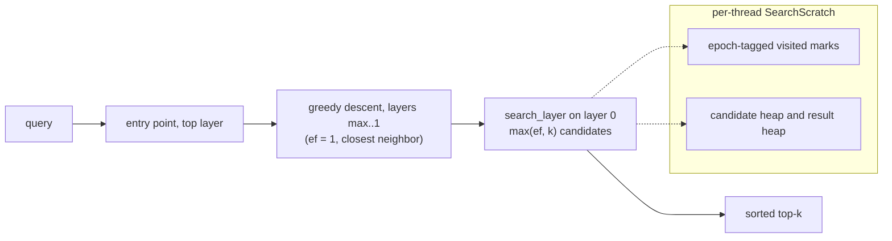

# Design

A from-scratch C++17 implementation of HNSW (Malkov and Yashunin, "Efficient and robust
approximate nearest neighbor search using Hierarchical Navigable Small World graphs") for
squared-L2 distance on x86-64. This document explains the decisions behind the code. It
contains no benchmark results; those are generated into the README from `bench/results/`.

## 1. Relation to the paper

| Paper | Code | Notes |
|---|---|---|
| Algorithm 1, INSERT | `HnswIndex::add` | Level `floor(-ln(U) * mL)` with `mL = 1/ln(M)`; `U` is built from the top 53 bits of the generator so levels are identical on every platform. |
| Algorithm 2, SEARCH-LAYER | `detail::search_layer` | Shared by insertion and query. Candidates and results are heaps over `(distance, id)`, which is a total order, so ties break by lower id and traversal is deterministic. |
| Algorithm 4, SELECT-NEIGHBORS-HEURISTIC | `HnswIndex::select_neighbors` | Used for the new node's links and whenever a neighbor's list overflows (`connect` re-selects over its links plus the new one). |
| Algorithm 5, K-NN-SEARCH | `search_graph_into` | Greedy descent (`ef = 1`, `detail::greedy_closest`) through layers above 0, then SEARCH-LAYER on layer 0 with `max(ef, k)` candidates. The insertion path uses the same greedy descent above the node's level. |

Layer 0 holds up to `2M` links, upper layers `M`. `HnswParams::keep_pruned` is the paper's
`keepPrunedConnections` and **defaults to off**. The simple selection of Algorithm 3 and the
paper's `extendCandidates` option are **not implemented** (the paper recommends the latter
only for extremely clustered data). Insertion is single-threaded.

## 2. Memory layout

Layer 0 is one contiguous arena of fixed-size records, so a node's links and vector are
adjacent and a neighbor expansion touches one or two cache lines of metadata plus the vector.
All arithmetic lives in `Layout` (`include/hnsw/layout.h`), a function of `(dim, M)` only.
For `dim = 128, M = 16` (values computed by `Layout::make`):

```
record (704 bytes = 11 x 64)
  0   +----------------------+
      | link count (u32)     |   4 B
  4   +----------------------+
      | 32 neighbor ids      | 128 B  (2M slots; the first `count` are valid, the rest zero)
 132  +----------------------+
      | zero padding         |  28 B
 160  +----------------------+   <- 32-byte aligned
      | vector, 128 floats   | 512 B
 672  +----------------------+
      | zero padding         |  32 B
 704  +----------------------+   next record
```

Records are 64-byte multiples and the arena is 64-byte aligned (`AlignedBuffer`), so every
vector is 32-byte aligned for the AVX2 loads and every record starts on a cache line.
The padding is deliberate and makes index files larger than a packed layout would.

**Upper layers** live in a separate table because most nodes are on layer 0 only. A `u8`
level array gives each node's top layer; a `u64` offset table gives, for nodes with level `l >= 1`,
the word index of its `l` blocks in one `u32` array. Each block is `[count][M ids]`, which for
`M = 16` is 17 words (68 bytes). Blocks are dense and in id order, so the offsets are
fully determined by the levels, and the loader checks exactly that.

**Everything is index-based.** Neighbors are `u32` ids, offsets are relative, and no pointer is
ever stored. The same bytes therefore describe an in-memory graph and a file: `save` writes
the arena verbatim, and a memory-mapped file is searched in place by the same `GraphView`
with no relocation or translation pass.

## 3. File format

[docs/FORMAT.md](FORMAT.md) is the byte-level specification: a 192-byte header (magic,
version, endianness marker, `dim`, `M`, section table, CRC-32 of the header), then the four
sections, each 64-byte aligned. `save` writes a temporary file, syncs it and renames it into
place, so readers see the old file or the complete new one. Any change to the bytes written
needs a new version number; a test pins a hash of a small deterministic file.

## 4. Search path



Search runs on a `GraphView`: a small struct of base pointers plus `Layout`, implemented once
and used by `HnswIndex` (owned memory) and `LoadedIndex` (mapped or read file). They therefore
return bit-identical results for the same kernel.

`SearchScratch` is the per-thread mutable state:

- **Visited marks** are 16-bit epoch tags: a node is visited iff its tag equals the current
  epoch, so starting a pass is O(1) rather than clearing an array. Tags are 16 bits to halve
  the cache footprint of 32 bits; the array is cleared once each time the epoch wraps. A
  dedicated test drives the epoch to wraparound.
- **Heaps** are the project's own binary heaps (`src/fixed_heap.h`) over buffers the scratch owns, with fixed capacity
  (candidates up to the node count, results `min(ef + 1, n)`). Once a scratch has served a query of
  a given graph size and `ef`, later queries allocate nothing; a test counts every `operator new`
  to prove it.
- **Prefetch**: while expanding a node's neighbor list the loop requests the visited tag and the
  first two lines of the vector of the neighbor two positions ahead.

Each of the three optimizations is a CMake option (`HNSW_OPT_*`) so it can be switched off for
the ablation; with all off the code is the plain algorithm.

## 5. Distance kernels

`l2_squared_scalar` is the reference. `l2_squared_avx2` uses four independent FMA accumulators so
consecutive FMAs do not wait on each other, with a scalar tail. `best_l2_squared()` picks one at
run time with `__builtin_cpu_supports`, so a binary built without `-march=native` still uses AVX2 on
a CPU that has it. The AVX2 file alone is compiled with `-mavx2 -mfma`; the dispatch and the rest
of the library are not, so the library runs on any x86-64 CPU. AVX2 tests skip (exit code 77) without
AVX2+FMA.

`-ffp-contract=off` is applied to exactly two places: `src/distance.cpp` and the golden test.
Under `-march=native`, GCC fuses `a*b + c` into FMA across statements where clang does not, so
the scalar kernel's rounding would differ by compiler. The golden test compares hashes of graphs
and search results against values generated once, and needs the scalar path to round identically
under both compilers. The other float math in the library (level sampling) multiplies by an exact power of two, so
fusing cannot change it, and explicit intrinsics are unaffected.

## 6. Concurrency

A built graph is read-only. Any number of threads may search one index at the same time, each with
its own `SearchScratch` (the overloads without one use a `thread_local`). `ThreadPool` is a persistent
pool: workers sleep on a condition variable, claim chunks of a batch from one atomic counter, and
each owns a cache-line-aligned scratch slot. `search_batch` runs on it and returns exactly what
sequential `search` returns. Insertion is not thread-safe.

The Python wrappers add one `std::shared_mutex` per index: searches take it shared, `add` takes it
exclusive. **The GIL is released before the lock is taken**, so a thread waiting for the lock never
holds the GIL, and the holder never needs the GIL to finish; otherwise a writer waiting for readers that
are waiting for the GIL would deadlock.

## 7. Untrusted files, `from_memory`, and fuzzing

The loader treats files as untrusted. The real file size is the ground truth and nothing is sized
from an unchecked header field. Shallow validation is O(1) (header, section bounds, overflow-checked
arithmetic). Deep validation (the default) walks every node: levels, upper offsets, link counts, every
link id (in range, not a self-loop, names a node that has that layer) and that every vector element is
finite. After deep validation, searching any accepted file is memory-safe, which is what makes
mapping a file you did not write reasonable. With `validate_deep = false` the file must be trusted.

To fuzz exactly the production checks, `LoadedIndex::open` only maps or reads the file and then calls the
same core that `LoadedIndex::from_memory(data, size, options)` exposes. The libFuzzer target feeds
bytes to it, searches whatever deep validation accepts, walks the graph through the accessors, and checks
that Read-mode `open` reaches the same verdict. Since libFuzzer cannot pass a CRC by chance, a custom
mutator recomputes the header CRC after each mutation; the production check is unchanged.

Two honest observations from the saved runs. Edge coverage of the loader target plateaued early: almost all
of the edges it ever reached were found within seconds, one more came much later, and only the finer-grained
features kept growing. That says this small format is explored quickly, not that it is exhausted. And the planted-bug check (deleting the link-id
bound check) was caught almost immediately, but that was an easy bug: it shows the fuzzing setup works,
not that it would find a subtle one. Figures are in the generated quality block of the README.

## 8. Testing strategy

- **Unit and property tests** per component, including exact comparison against brute force, graph
  invariants (`check_invariants`), connectivity, determinism, and edge cases (empty index, one node,
  `k > n`, duplicates).
- **Golden test**: hashes of the graph and of search results for fixed configurations, generated
  by `tests/gen_golden.sh` from the first scalar baseline (tag `m2-scalar-baseline`). Later optimizations
  must not change the graph or any result.
- **Format tests** written against `docs/FORMAT.md` with an independent CRC and offsets, plus
  truncation at every length, byte flips, and crafted headers that must fail fast without large allocations.
- **Manual mutation checks.** During development, bugs were planted by hand to see whether tests noticed;
  one survivor (removing the epoch clear on wraparound) led to a stronger test. There is no automated
  mutation-testing tool and no coverage target.
- **Sanitizers**: the whole suite under ASan, UBSan, ASan+UBSan and TSan with GCC and clang
  (`scripts/sanitize.sh`), UBSan aborting on any finding; the Python extension is also run under ASan with the runtime
  preloaded. Evidence is saved in `docs/evidence/`.
- **hnswlib exemptions.** Sanitizer findings inside the third-party baseline (benchmarks only, never the library) are
  exempted narrowly: ASan off for the one file that includes hnswlib (a prefetch over-read of one neighbor id); UBSan's
  alignment and pointer-overflow checks off there (a misaligned 8-byte label store and the same prefetch address
  arithmetic); and TSan lock-order checking off for the one test that runs hnswlib, because its insertion takes two
  mutexes in both orders and the benchmark inserts from one thread so the reported cycle cannot deadlock. Reasons are
  in `bench/CMakeLists.txt`.
- **CI** runs all of it on every push (see `.github/workflows/ci.yml`).

## 9. Benchmark method and ablation design

The method is in [docs/TASK.md](TASK.md) and the tools are in [bench/README.md](../bench/README.md). In short: SIFT1M,
recall@10 versus queries per second by sweeping `ef`, compared with hnswlib v0.9.0 built from a pinned commit with the same
flags, the same `M` and `efConstruction`, on the same machine, with warm-up and medians of repeated runs, and the hardware,
compiler and flags recorded in every result file.

The ablation measures each optimization separately. The epoch visited list, allocation-free heaps and prefetch are
compile-time switches, so all combinations are run (each with the scalar and the AVX2 kernel) against the **same index
file**, at fixed `ef` points, interleaved round robin, requiring identical result ids across combinations of the same kernel.
The memory layout cannot be switched off, so its "off" arm is the first baseline (tag `m2-scalar-baseline`, built through its public
API). That baseline's scalar rounding differs from AVX2's, so it would build a different graph; the layout comparison
therefore uses an index **built with the scalar kernel** by our code, which is the same graph the baseline builds, and both arms search it. Each
M2 repetition is bracketed by measurements of the all-off variant to detect drift.

## 10. Known behavior and limits

- **Many exact duplicates.** With far more identical vectors than `M`, later copies all link to the lowest-id copies, whose lists
  fill with distance-0 ties, and the shrink step drops the links back, so some copies become unreachable on layer 0. The graph
  stays valid and every result is an exact match, but fewer than `k` results may be returned. A test pins this behavior.
- **Ties** are broken by lower id everywhere (search, heaps, results), so results are deterministic.
- **x86-64 only** (CMake refuses other processors); the format is little-endian and the loader refuses big-endian hosts.
- **Index files are larger than hnswlib's** because records are padded to alignment (section 2); that is a space-for-speed choice.
- **A memory-mapped file must not be truncated or modified** while it is loaded. Validation runs once at open, and the file is the
  index's memory. Replacing it with `save` is safe (rename).
- **Only squared L2.** The metric field exists in the format but only id 0 is defined.
- **The Python type stub is hand-written** (`__init__.pyi`) and is not generated from the bindings, so it can drift from them.
- **The Python lock favors readers.** `std::shared_mutex` on glibc defaults to reader preference, so under a continuous stream
  of searches an `add` can wait indefinitely.
- **Residual false sharing.** Pool scratch slots are cache-line aligned, but the vectors inside a scratch (tags, heap buffers)
  are separate `malloc` allocations whose edges can share a line with another thread's allocation.
- **No deletes, no concurrent inserts, no filtered search, and the graph must fit in memory or be mapped** (mmap pages in on
  demand, but there is no out-of-core construction).
